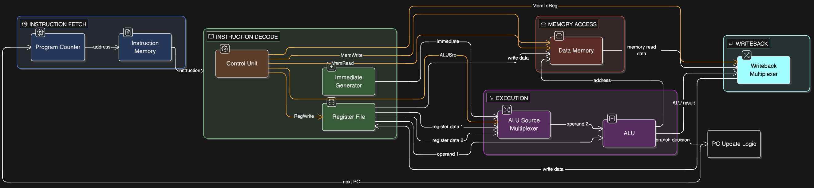

# 5-Stage Pipelined RISC-V Processor (RV32I)

A 32-bit in-order pipelined processor implementing 38 of the 40 RV32I base
integer instructions. Written from scratch in Verilog, verified with a directed
test suite of 15 self-checking programs — which is itself mutation-tested by
injecting faults into the RTL and confirming each test catches them.

| | |
|---|---|
| Instructions | 38 / 40 RV32I (missing `ECALL`, `EBREAK`) |
| Hazard coverage | 13 / 13 scenarios, each mutation-validated |
| Tests | 15, all passing |
| Simulation | Icarus Verilog + GTKWave |
| FPGA | **Not yet synthesizable** — see [Status](#status) |

## Overview

Instructions execute through a classic 5-stage pipeline: Instruction Fetch,
Decode, Execute, Memory, Write-Back. Five instructions are in flight at once,
with forwarding, a load-use interlock, and branch/jump flushing to keep results
correct.

The design follows the Harvard architecture, with separate instruction and data
memories addressable in the same cycle.



### Supported instructions

| Class | Instructions |
|---|---|
| R-type | `ADD` `SUB` `SLL` `SLT` `SLTU` `XOR` `SRL` `SRA` `OR` `AND` |
| I-type ALU | `ADDI` `SLTI` `SLTIU` `XORI` `ORI` `ANDI` `SLLI` `SRLI` `SRAI` |
| Load | `LB` `LH` `LW` `LBU` `LHU` |
| Store | `SB` `SH` `SW` |
| Branch | `BEQ` `BNE` `BLT` `BGE` `BLTU` `BGEU` |
| Jump | `JAL` `JALR` (with the spec-required LSB clear) |
| Upper immediate | `LUI` `AUIPC` |
| Misc | `FENCE` (architectural NOP on a single-hart, in-order, cacheless core) |

Not implemented: `ECALL` and `EBREAK`. Both require trap machinery — `mtvec`,
`mepc`, `mcause`, and a privilege model — which is out of scope. Full per-
instruction matrix in [COVERAGE.md](COVERAGE.md).

## Architecture

### Pipeline stages

| Stage | Module(s) | Description |
|---|---|---|
| IF | `pc.v`, `instruction_mem.v` | Fetch instruction, increment PC |
| ID | `control_unit.v`, `reg_file.v` | Decode, read registers, generate immediate |
| EX | `alu.v` | ALU operation, branch condition, branch/jump target |
| MEM | `data_mem.v` | Read or write data memory, sub-word extension |
| WB | (in `riscv_top.v`) | Select and write result back to the register file |

The forwarding unit, hazard-detection unit, immediate generator, ALU-control
decoder and writeback mux all live inline in `riscv_top.v` rather than as
separate modules.

### Hazard handling

- **Forwarding** — RAW hazards at distance 1 and 2 are resolved by routing
  results from EX/MEM or MEM/WB back to the EX inputs. EX/MEM takes priority
  when both match, so the newer value wins.
- **Write-first register file** — a read in the same cycle as a write to the
  same register returns the new data. This covers RAW at distance 3, which is
  past the reach of forwarding. Its absence was a real bug; see
  [errors_fixed.md](errors_fixed.md), Fix 0.
- **Load-use interlock** — a load followed immediately by a dependent
  instruction stalls one cycle: the PC freezes, IF/ID holds, and a bubble is
  injected into ID/EX. Forwarding cannot fix this one, because the loaded data
  does not exist yet.
- **Branch and jump flush** — conditional branches resolve in EX on a
  `funct3`-selected comparator; `JAL`/`JALR` redirect unconditionally. Both
  reuse one `redirect` signal, flushing the two wrong-path instructions already
  in ID and IF.

### Key components

- **Program counter** — clocked register; holds on stall, redirects on branch or jump.
- **Control unit** — decodes the 7-bit opcode into datapath control signals.
- **ALU** — ten operations, with signed/unsigned comparison and arithmetic vs logical shift.
- **Register file** — 32 × 32-bit, `x0` hardwired to zero on both read and write, write-first bypass on both read ports.
- **Data memory** — 4 KB, word-addressed, with per-lane byte enables for `SB`/`SH`.

## Verification

15 self-checking tests. Each asserts on expected register values and reports
`PASS`/`FAIL` itself rather than leaving a waveform for a human to read.

```bash
bash tests/run_tests.sh          # everything
bash tests/run_tests.sh loads    # one test by name
```

Test programs are written in assembly under `tests/progs/` and assembled by
`tests/asm.pl`, a two-pass RV32I assembler with label support.

### The suite is mutation-tested

A test that passes proves nothing until you have seen it fail. Each hazard test
was validated by deliberately breaking the RTL and confirming the right
assertion — and only that one — went red:

| Injected fault | Caught by |
|---|---|
| Reverse forwarding priority | `fwd` — contention case returns the stale value |
| Force `stall = 0` | `loaduse` — both ALU and branch consumers break |
| Reduce flush depth to 1 | `flush` — the second wrong-path instruction survives |
| Allow writes to `x0` | `x0` — `registers[0]` becomes non-zero |

Details in [COVERAGE.md](COVERAGE.md).

## Status

**This runs in simulation. It is not ready for an FPGA.** Being specific about
why, since the repo targets a Basys 3 (Artix-7 XC7A35T):

- `riscv_top` has no output ports, so synthesis would optimise the entire
  design away.
- Neither memory infers Block RAM — both reads are combinational, and
  `data_mem`'s is additionally gated by `mem_read`.
- There is no `.xdc` constraints file and no Vivado project.

[next_steps.md](next_steps.md) lays out a six-phase route to fixing that, with
the learning goal named for each phase.

## Documentation

| File | Contents |
|---|---|
| [CLAUDE.md](CLAUDE.md) | Architecture audit, module hierarchy, file map, toolchain notes, known issues |
| [COVERAGE.md](COVERAGE.md) | Per-instruction and per-hazard coverage matrices, with what is deliberately untested and why |
| [errors_fixed.md](errors_fixed.md) | Every bug fixed, with the failing evidence before and passing evidence after |
| [next_steps.md](next_steps.md) | FPGA readiness roadmap |

## How to run

1. Install Icarus Verilog (bundles GTKWave). On Windows:
   `winget install --id Icarus.Verilog`, then add `C:\iverilog\bin` and
   `C:\iverilog\gtkwave\bin` to PATH — the silent installer does not.
2. From the repo root:

   ```bash
   bash tests/run_tests.sh
   ```

3. Or build and run the original integration test directly:

   ```bash
   iverilog -o riscv_sim src/*.v test/top_tb.v
   vvp riscv_sim
   gtkwave riscv_processor.vcd
   ```

Run from the repo root either way — `instruction_mem` resolves its program file
relative to the working directory.
